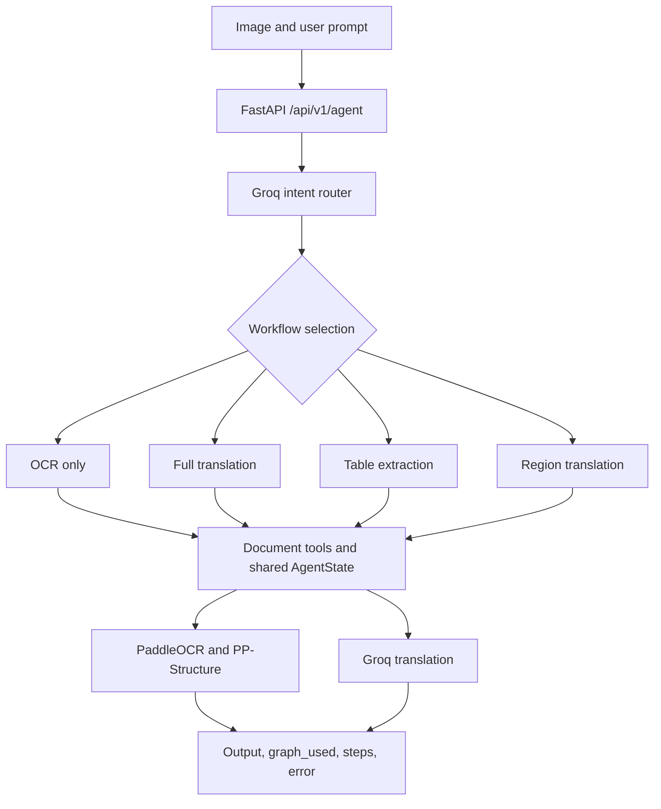

# Agentic Document Orchestrator

**Natural-language routing for document layout analysis, OCR, table extraction, and translation.**

Upload a document image and describe the task. A Groq-powered intent router selects one of four predefined LangGraph workflows, which call reusable document-processing tools and return the output together with the selected graph and an execution trace.

Built with **FastAPI · LangGraph · PaddleOCR / PP-Structure · Groq**.

> **Current scope:** A document workflow orchestration prototype with one intent router and deterministic processing graphs. The current implementation does not include independent collaborating agents, open-ended planning, conversational memory, or general document question answering.

## What it does

| Workflow | Processing path | Output |
| --- | --- | --- |
| `ocr_only_graph` | Full image → OCR → merge text | Extracted text |
| `full_translate_graph` | Layout → filter → crop → OCR → merge → translate | Translated text |
| `table_extract_graph` | Layout → table regions → crop → OCR → row clustering | Markdown table |
| `translate_region_graph` | Layout → filter and sort regions by area → crop → OCR → merge → translate | Translated text from selected region types |

The region workflow currently processes **all matching regions**, sorted largest first. It does not yet resolve a prompt such as “translate only the second table” to one specific region.

## Architecture



- **Router:** Requests a JSON graph name and language codes from Groq. Unavailable clients, request failures, malformed output, and unknown graphs fall back to `ocr_only_graph`.
- **Workflow layer:** Builds and caches four LangGraph graphs; nodes exchange image bytes, regions, OCR results, text, and step logs through `AgentState`.
- **Tool layer:** Wraps layout detection, region filtering, cropping, OCR, text merging, table formatting, and translation with timing logs.
- **Engine layer:** Lazily initializes PP-StructureV2, English PP-OCRv4, and the Groq translation client.
- **API layer:** Exposes both orchestration and individual processing services.

## Setup

### Requirements

- Python **3.13+**, as currently declared in `pyproject.toml`; `.python-version` selects 3.13.
- `uv` or a Python virtual environment with pip.
- A Groq API key for intent routing and translation.
- A platform and native libraries compatible with the pinned PaddleOCR 2.x / PaddlePaddle stack. OCR models may download on first use.

The dependency file still contains packages from earlier local-model experiments. In particular, `numpy<2` and older OCR/OpenCV dependencies can complicate installation on Python 3.13. The commands below describe the declared environment; a complete OCR installation has not been verified across platforms. Dependency cleanup and a tested lockfile remain planned work.

```bash
git clone https://github.com/caubetotbunggg/agentic-orchestrator.git
cd agentic-orchestrator
cp .env.example .env
# Edit .env and supply your own GROQ_API_KEY.
uv sync
uv run uvicorn app.main:app --reload
```

Keep `.env` local; it is ignored by Git. On Windows, copy the file with `Copy-Item .env.example .env` in PowerShell.

If using pip instead of uv, create and activate a Python 3.13 virtual environment, then run `python -m pip install -e .` and `python -m uvicorn app.main:app --reload`.

### Configuration

| Variable | Purpose | Example |
| --- | --- | --- |
| `GROQ_API_KEY` | Groq credential | Set locally in `.env` |
| `GROQ_ORCHESTRATOR_MODEL` | Model used for intent classification | `openai/gpt-oss-20b` |
| `GROQ_MODEL` | Model used for translation | `openai/gpt-oss-20b` |

The router defaults to `openai/gpt-oss-20b`; the translation service requires `GROQ_MODEL` to be set. Model availability depends on the provider and account; use an exact ID from the [Groq supported models](https://console.groq.com/docs/models) page. Language parameters retain NLLB-style codes such as `eng_Latn` and `vie_Latn` for the API contract, but translation runs through Groq, not a local NLLB model.

Open these local URLs after starting the server:

- Health endpoint: `http://127.0.0.1:8000/`
- Interactive API documentation: `http://127.0.0.1:8000/docs`

The health endpoint reports that the app is running; it does not verify OCR model readiness or Groq credentials.

## Try the API

Use a local PNG or JPEG image. PDF rasterization and multi-page uploads are not implemented.

### Route a natural-language task

```bash
curl -X POST http://127.0.0.1:8000/api/v1/agent \
  -F 'file=@document.png' \
  -F 'prompt=Extract all text from this image without translation.' \
  -F 'src_lang=eng_Latn' \
  -F 'tgt_lang=vie_Latn'
```

Illustrative response; extracted text and step counts depend on the image:

```json
{
  "output": "Invoice number 001",
  "graph_used": "ocr_only_graph",
  "steps": [
    "router → ocr_only_graph",
    "ocr_full → 3 text items",
    "merge_text → done"
  ],
  "error": null
}
```

Other example prompts: `Translate all text in this image into Vietnamese.` and `Extract the tables as Markdown.` The router selects the workflow; the API does not expose a graph override.

### Call individual tools

```bash
# OCR: image → text items with bounding boxes and confidence
curl -X POST http://127.0.0.1:8000/api/v1/ocr \
  -F 'file=@document.png'

# Crop: image + [x1, y1, x2, y2] → PNG
curl -X POST http://127.0.0.1:8000/api/v1/crop \
  -F 'file=@document.png' -F 'bbox=[0,0,400,300]' \
  --output cropped.png

# Translation expects a UTF-8 text file, not an image
curl -X POST http://127.0.0.1:8000/api/v1/translate \
  -F 'file=@text.txt' -F 'src_lang=eng_Latn' -F 'tgt_lang=vie_Latn'
```

### Endpoints

| Method | Path | Input | Result |
| --- | --- | --- | --- |
| GET | `/` | None | `{"status":"ok"}` |
| POST | `/api/v1/agent` | Image, `prompt`, optional language codes | `output`, `graph_used`, `steps`, `error` |
| POST | `/api/v1/layout-detect` | Image | Region types, bounding boxes, confidence |
| POST | `/api/v1/ocr` | Image | Text items, bounding boxes, confidence |
| POST | `/api/v1/translate` | UTF-8 text file, optional language codes | `translated_text` |
| POST | `/api/v1/crop` | Image, JSON `bbox` form field | PNG image |

POST inputs use `multipart/form-data`. Language defaults are English (`eng_Latn`) to Vietnamese (`vie_Latn`). Agent execution errors become HTTP 500 responses with `detail`; successful agent responses normally contain `error: null`.

## Project layout

```text
.
├── app/main.py           # FastAPI app and health endpoint
├── api/
│   ├── routes.py         # HTTP endpoints and upload handling
│   └── schemas.py        # Pydantic request/response data structures
├── agent/
│   ├── __init__.py       # run_agent entry point
│   ├── router.py         # Groq intent classification and fallback
│   ├── graphs.py         # four predefined LangGraph workflows
│   └── state.py          # shared workflow state
├── tools/document_tools.py  # reusable processing tools and timing logs
├── engine/services.py    # OCR, layout, cropping, and Groq translation
├── .env.example          # configuration template without credentials
└── pyproject.toml        # package metadata and dependencies
```

## Current limitations and next steps

- **Document handling:** Single images only; OCR is configured for English. Multi-page PDFs, language-aware OCR, and prompt-directed region selection need implementation.
- **Reading order and tables:** Text is merged by coordinates; coordinates from different crops are not remapped into page space. Table reconstruction uses simple row clustering and can mix multiple tables or misread merged cells.
- **Routing and translation:** Routing can silently fall back to OCR. Translation makes one request capped at 4,096 output tokens, without long-document chunking or retries.
- **Service behavior:** Synchronous model calls run inside async endpoints. There is no worker queue, upload limit, authentication, or persistent job state.
- **Evaluation:** No automated test suite, sample document collection, or published quality/latency benchmark is included yet. Add routing fixtures, graph tests with mocked tools, and end-to-end document examples before making performance claims.
- **Environment:** Remove unused local-model dependencies, validate the OCR runtime, and commit a reproducible dependency lockfile.

This repository currently has no license file granting general reuse rights.
